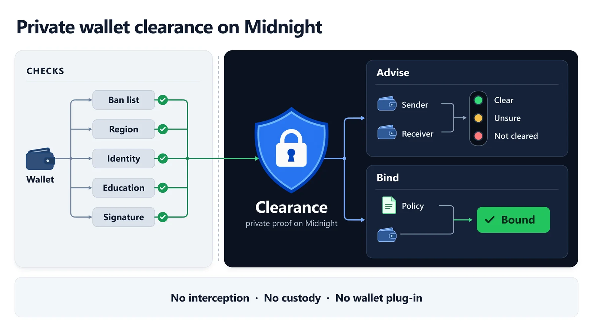

# CryptoSure

**Privacy-preserving insurance for crypto.**

CryptoSure is building a new category of insurance: defined, provable
coverage for crypto held in wallets, from everyday self-custody to
institutional treasury and custodial arrangements.

The wager is simple. Crypto is uniquely insurable: every loss leaves a
permanent, verifiable trail; ownership can be proven cryptographically;
and losses can be prevented, tracked, and in many cases recovered. The
insurance market just hasn't been built for it yet. We're building it.

## What we're exploring

- Coverage that knows what it covers: written scope, bound to the policy,
  no ambiguity at claim time
- Education-gated protection: the safest holders earn the best terms
- Loss prevention as a feature: tooling that intervenes at dangerous
  moments, not after them
- Privacy-first verification: proving what matters without exposing who
  you are or what you hold
- Recovery-aware claims: claims that trace and fight, not just pay

## The Build Club MVP: clear a wallet once, use it two ways

A wallet is **cleared** by passing a set of checks. The result is recorded
on Midnight as a pass against an anonymous ticket: the chain learns that
*some* wallet passed, and nothing about whose. A clearance can then be used
two ways:

- **Advise on a transfer.** Are the sender and the receiver both clear?
  The answer is advice. Nothing is held, blocked, or routed through us.
- **Bind a policy.** A cleared wallet can be bound to an insurance policy.



### One contract per job

Each check is its own contract, and so is each use of a clearance. Any one
can be replaced without touching the others.

| Contract | Its one job |
|---|---|
| `checks/BanListCheck` | Has this wallet been screened against the ban list, recently, and cleared? |
| `checks/RegionCheck` | Is the holder in a region the program serves? |
| `checks/IdentityCheck` | Has an approved issuer verified the holder, and how strongly? |
| `checks/EducationCheck` | Has the holder passed the required education, and to what level? |
| `checks/WalletControlCheck` | Does the holder control the wallet they are asking about? |
| `ClearanceRegistry` | Does this ticket hold every pass a profile asks for? Then record the clearance. |
| `PairReceipt` | Were two tickets, a sender and a receiver, both clear at this moment? Issue a dated receipt. |
| `PolicyBinder` | Bind a policy to a wallet that is cleared for what that policy demands. |

```
 five check contracts ──► ClearanceRegistry ──► PolicyBinder
 (each answers                 │
  require_pass)                └──────────────► PairReceipt
```

- **Slots.** The registry keeps eight numbered slots, each pointing at a
  check contract. Five are used. An administrator can repoint a slot at a
  new contract or plug a new kind of check into a free one.
- **Profiles.** A profile is a list of minimum levels, one per slot. "How
  much checking is enough" is data in `config/program.json`, not code.
- **Shelf life.** Every pass expires on its own schedule (a ban-list pass in
  a day, an identity pass in months). A clearance never outlives its weakest
  pass, and passes that are still good are reused, not repeated.
- **Fail fast.** Checks run cheapest first and stop at the first failure.
- **Three outcomes.** Clear, unsure, or not cleared.

The contracts call each other with Midnight's cross-contract calls, which
need ledger 9 and Compact toolchain 0.36.1. Design notes, what is disclosed
on-chain, and known limits: [`docs/design/protocol.md`](docs/design/protocol.md).

### Providers are black boxes

The protocol does not know how to answer any of the five questions. Each
answer comes from a provider: a question goes in, and pass, refuse or
unknown comes out, with an opaque reference and never a reason. This
repository ships only **mock** providers with synthetic answers, so it runs
anywhere. Real providers live in their own repositories and plug in through
the interface in [`protocol/providers/README.md`](protocol/providers/README.md).

### Run it

Needs Node.js 22 or later and the Compact toolchain 0.36.1.

```bash
npm install
npm run compile   # about a minute: compiles the eight contracts with keys
npm run demo      # clears a cast of wallets, checks pairs, binds policies
npm test          # 93 tests
```

Most of the tests call the contracts directly, skipping our own software, to
show each contract refuses bad input on its own. One file plays a dishonest
device that lies to the contracts about its private inputs.

### What is real and what is simulated

| Piece | Status |
|---|---|
| The eight contracts | **Real.** Compiled with full proving keys; the tests and demo run the compiled circuits. |
| Cross-contract calls | **Real code path, run locally.** The Compact runtime executes them against local contract state. |
| The chain | **Local stand-in.** Nothing is deployed to a Midnight network and no proofs are generated. |
| Providers | **Mock.** Synthetic answers from `fixtures/mock-subjects.json`. |
| Wallet signatures | **Stand-in keys.** Real signatures, checked for real, but not made by the actual wallets. |
| The people | **Fictional**, from the public [TestTown](https://github.com/bytewizard42i/TestTownDIDz) test population. Their wallets are unfunded test addresses. |
| Policies | **Placeholders.** No policy has been sold and none is offered. |

## Repository layout

```
contracts/
  checks/                 the five check contracts
  ClearanceRegistry       turns passes into one clearance
  PairReceipt             a dated receipt for two clear wallets
  PolicyBinder            binds a policy to a cleared wallet
  lib/                    code shared by the contracts (roles, tickets, passes, Merkle membership)
  legacy/                 the first single-contract version, kept for reference
protocol/
  local-chain.mjs         runs the compiled contracts locally
  program.mjs             deploys and wires the eight contracts
  clearance.mjs           clear one wallet
  pair-check.mjs          advise on a sender and a receiver
  bind-policy.mjs         bind a policy to a cleared wallet
  providers/              the provider interface and the mock providers
  run-demo.mjs            the demo
config/program.json       slots, profiles, cover classes, regions
fixtures/                 synthetic answers for the mock providers
tests/                    contract-level and protocol-level tests
docs/                     design notes, Build Club homework, pitch resources
```

## See it

[cryptosure.pro](https://cryptosure.pro) ·
[demo.cryptosure.pro](https://demo.cryptosure.pro)

## Status

Early build. We are developing in the open where it helps and keeping the
rest close where it matters.

## Legal

Copyright (c) 2026 EnterpriseZK Labs LLC. All rights reserved. This repository
is published so it can be read and inspected; no license to copy, modify, or
use its contents is granted.

CryptoSure has not sold any policy. Nothing in this repository is an offer or
solicitation of insurance, and nothing here is legal, actuarial, or insurance
advice.

---

*Built on Midnight. Built to last.*
