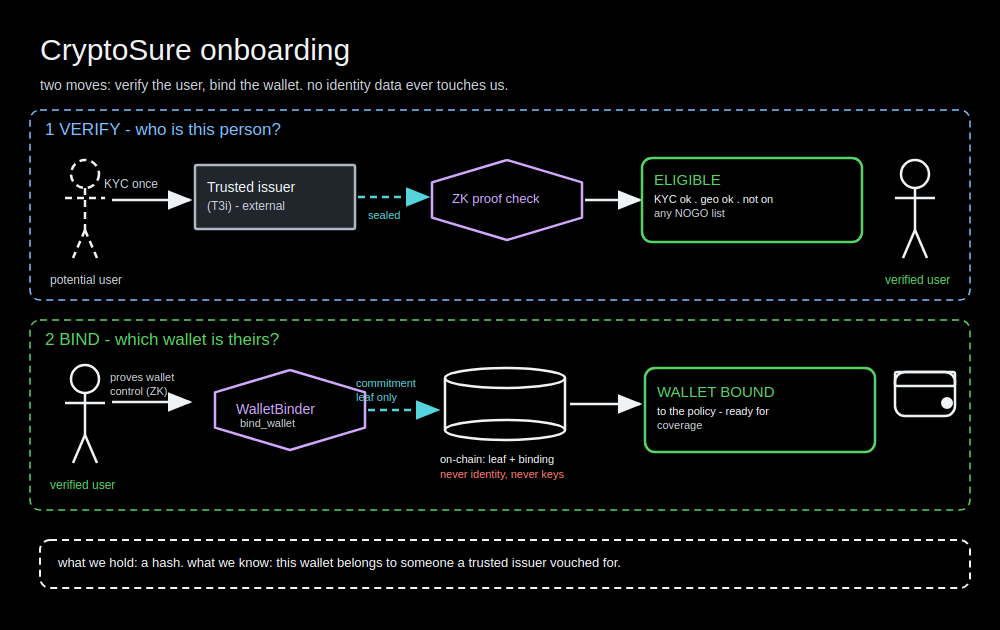

# Week 4 — Roadmap to Pitch Day

**What we will be shipping:** one thing, working — the front door.
Verify the user, bind their wallet to the policy. That is the demo.

## Ship / deliberately not ship

| Shipping | Not shipping |
|---|---|
| User verification via a regulated issuer (we see a proof, never identity) | Claims automation |
| Wallet-control proof | Recovery flows |
| Wallet → policy binding on-chain | Carrier tooling |

## Weeks we believe in

| Week | Piece | Owner |
|---|---|---|
| 1 | WalletBinder contract + binding proof | John |
| 2 | Issuer verification flow (mock issuer fixture) | John |
| 3 | Demo UX wiring + polish | John |
| 4 | Buffer + pitch rehearsal | John + David |

## The risk we are most worried about

**Issuer integration not solid by pitch day.**
Fallback: demo against a simulated issuer. The wallet binding — the part
that is ours — still runs live. Either way, the door opens.
